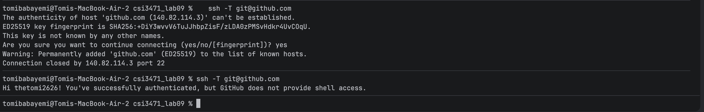
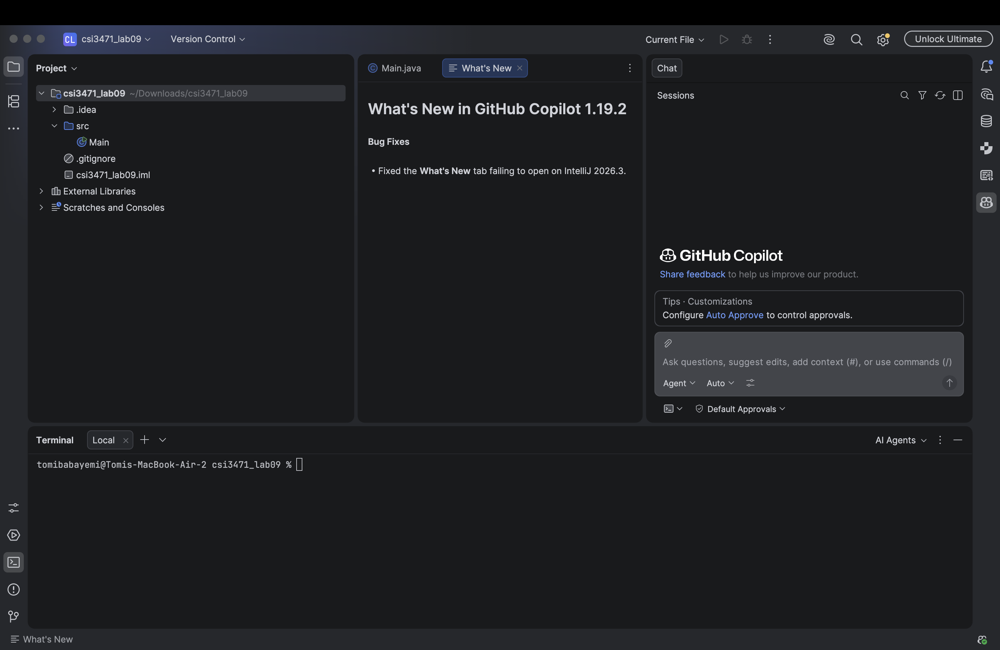
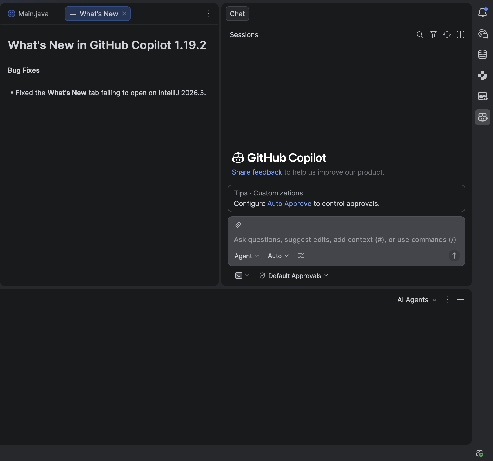
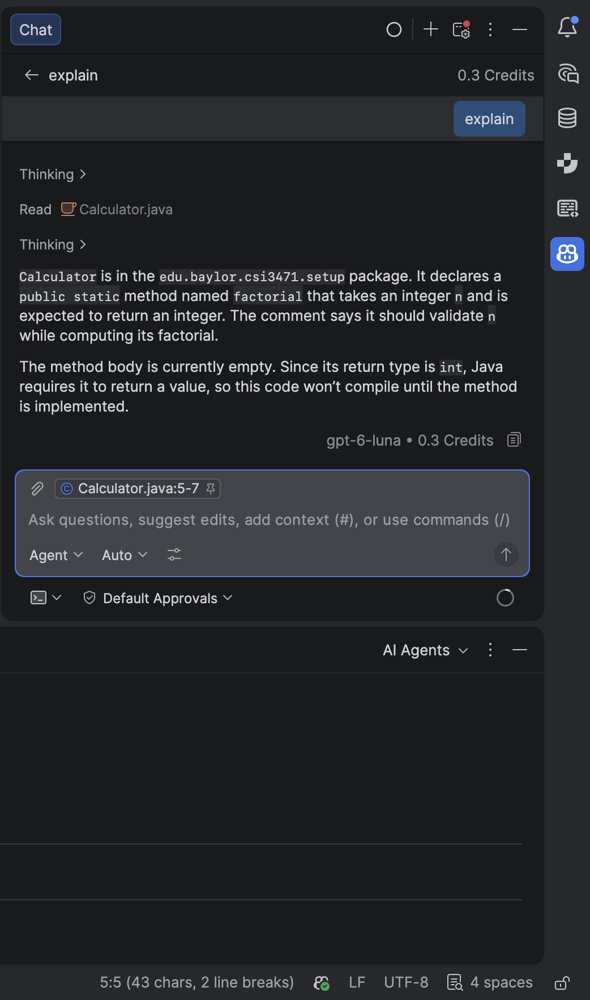

# Lab 09 Verification Report
**Student Name:** Tomi Babayemi  
**BearID:** Tomi_Babayemi1  
**GitHub Username:** thetomi2626  
**Date:** October 26, 2026

## 1. Tooling Verification
- Git Version: <<git version 2.39.5 (Apple Git-154)>>
- Global Git Config: user.name = thetomi2626, user.email = Tomi_Babayemi1@baylor.edu
- Copilot Modality Verified: Inline Completion (Ghost Text) & Copilot Chat

## 2. Evidence Screenshots

**Screenshot 1: Git authentication test (`ssh -T git@github.com`)**

**Screenshot 2: Active Copilot status in IDE**

**Screenshot 3: Inline ghost text suggestion before pressing Tab**

**Screenshot 4: Copilot Chat /explain response**

